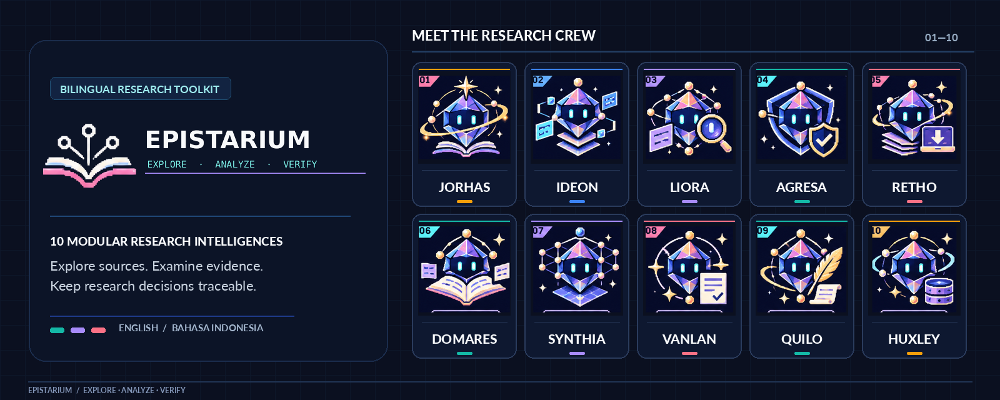
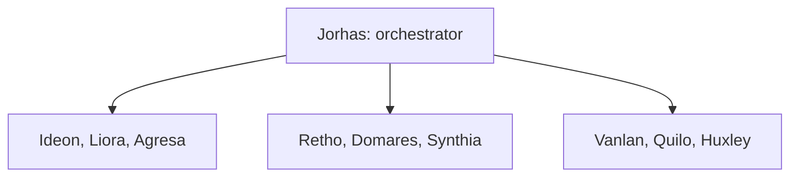

[English](README.md) | Bahasa Indonesia

<!-- EPISTARIUM_HERO_BEGIN -->

<!-- EPISTARIUM_HERO_END -->

<!-- section: identity -->
# EPISTARIUM

Explore. Analyze. Verify.

Modular AI Research Skills

v0.8.0 RELEASE_CANDIDATE. Sepuluh persona penelitian, English dan Bahasa Indonesia, satu basis kode.

MIT mencakup karya orisinal EPISTARIUM. Runtime memakai pypdfium2 dan pypdf. Gerbang rilis: GO_BERSYARAT.
Baca [lisensi](docs/id/LICENSING.md) dan [kesiapan rilis](reports/v0.7.1/RELEASE_READINESS.id.md).

<!-- section: quickstart -->
## Mulai di sini

Di halaman repositori GitHub, pilih **Code > Download ZIP**, atau gunakan aset ZIP rilis versi 0.7.1 ketika sudah tersedia. Ekstrak ZIP, lalu buka folder yang berisi `pyproject.toml`, `AGENTS.md`, dan `.agents/skills/`. Nama folder hasil ekstraksi dapat berbeda menurut cara mengunduhnya.

Gunakan Python 3.11 atau lebih baru. Linux dengan Python 3.12.14 telah diuji di sini. Kombinasi OS/Python lain memerlukan pengujian tersendiri.
Baca [gerbang lisensi PDF](docs/id/LICENSING.md) terlebih dahulu.

Pada macOS atau Linux:

```bash
python3 -m venv .venv
.venv/bin/python -m pip install .
.venv/bin/python -m epistarium doctor --lang en
.venv/bin/python -m epistarium ideon-origo --input examples/bilingual/origo.en.json --lang en --out private/first-map-en
```

Pada Windows PowerShell:

```powershell
py -3.14 -m venv .venv
.\.venv\Scripts\python.exe -m pip install .
.\.venv\Scripts\python.exe -m epistarium doctor --lang id
.\.venv\Scripts\python.exe -m epistarium ideon-origo --input examples/bilingual/origo.id.json --lang id --out private/first-map-id
```

Contoh Windows memilih Python 3.14 yang telah terpasang. Ikuti panduan Windows jika interpreter itu belum tersedia.
Contoh ini menggunakan masukan sintetis. Peta yang dihasilkan merupakan draf, bukan bukti penelitian.
Gunakan folder keluaran baru untuk setiap eksekusi. Pilih --lang en, --lang id, atau --lang auto.
Bahasa tidak mengubah kutipan sumber, DOI, nama, angka, atau kode status kanonis.

Ikuti [Penelitian Pertama](docs/id/FIRST_RESEARCH.md) untuk membaca keluaran dan menjalankan alur sumber hingga telaah secara aman.

## Research Observatory langsung (v0.8.0)

Pantau langkah Python Jorhas yang benar-benar berjalan, status sepuluh persona, jumlah rekaman bukti, artefak, dan gerbang persetujuan melalui antarmuka lokal dwi-bahasa (bawaan EN, dapat memilih ID) dengan mode gelap dan terang. Eksekusi selesai **tidak berarti** pembuktian semantik selesai.

```bash
python -m epistarium observatory --open
```

Untuk menjalankan Path Finding lokal, tambahkan `--idea "Topik penelitian" --mode pathfind`. Pembukaan browser otomatis memerlukan lingkungan desktop dan izin sistem. Lihat [panduan Observatory Bahasa Indonesia](docs/id/observatory/README.md) atau [English guide](docs/en/observatory/README.md). Dashboard ini bukan plugin ChatGPT web.

<!-- section: installation -->
## Pasang sesuai lingkungan

[Windows 10/11](docs/id/install/windows.md) · [macOS Intel / Apple Silicon](docs/id/install/macos.md) · [Linux](docs/id/install/linux.md)

[OpenCode](docs/id/platforms/opencode.md) · [Google Antigravity](docs/id/platforms/antigravity.md) · [OpenAI Codex](docs/id/platforms/codex.md) · [ChatGPT](docs/id/platforms/chatgpt.md) · [Claude Code / Claude web](docs/id/platforms/claude.md) · [Gemini CLI / Gemini web](docs/id/platforms/gemini.md) · [GitHub Copilot](docs/id/platforms/copilot.md) · [Cursor](docs/id/platforms/cursor.md) · [Windsurf](docs/id/platforms/windsurf.md) · [Amp](docs/id/platforms/amp.md)

Discovery native telah didokumentasikan untuk sejumlah host. Hal itu terpisah dari keberhasilan eksekusi aplikasi.
Baca [matriks kompatibilitas](reports/v0.7.0/COMPATIBILITY_MATRIX.id.md) untuk hasil PASS, BLOCKED, dan NOT_RUN.
Wheel hanya memasang perangkat Python. ZIP juga memuat skill, panduan, contoh, dan tes.
EPISTARIUM belum menyediakan plugin marketplace atau installer npx yang terverifikasi.

<!-- section: catalog -->
## Kenali Research Intelligences

| Persona dan gelar | Fungsi | Permintaan | Panduan |
|---|---|---|---|
| Jorhas<br>The Path Finder | Master Diving | Carikan bukti dan tiga alternatif fokus penggunaan AI oleh mahasiswa. | [SKILL](.agents/skills/jorhas-master-diving/SKILL.md) · [Lengkap](.agents/skills/jorhas-master-diving/references/guide.id.md) |
| Ideon<br>The Research Architect | Topic Brainstormer / ORIGO | Susun tiga alternatif rancangan dari ide penelitian saya. | [SKILL](.agents/skills/ideon-topic-brainstormer/SKILL.md) · [Lengkap](.agents/skills/ideon-topic-brainstormer/references/guide.id.md) |
| Liora<br>The Literature Scout | Literature Scout | Carikan studi lima tahun terakhir tentang komunikasi krisis digital. | [SKILL](.agents/skills/liora-literature-scout/SKILL.md) · [Lengkap](.agents/skills/liora-literature-scout/references/guide.id.md) |
| Agresa<br>The Index Sentinel | Index Verifier | Periksa jurnal ini menggunakan rekaman indeks resmi yang saya berikan. | [SKILL](.agents/skills/agresa-index-verifier/SKILL.md) · [Lengkap](.agents/skills/agresa-index-verifier/references/guide.id.md) |
| Retho<br>The Paper Retriever | Fulltext Retriever | Periksa PDF berizin untuk kandidat literatur ini. | [SKILL](.agents/skills/retho-fulltext-retriever/SKILL.md) · [Lengkap](.agents/skills/retho-fulltext-retriever/references/guide.id.md) |
| Domares<br>The Critical Reader | Critical Reader | Baca artikel berizin ini dan temukan bagian metode serta temuannya. | [SKILL](.agents/skills/domares-critical-reader/SKILL.md) · [Lengkap](.agents/skills/domares-critical-reader/references/guide.id.md) |
| Synthia<br>The Knowledge Weaver | Literature Review | Susun matriks literatur dari hasil pembacaan kritis ini. | [SKILL](.agents/skills/synthia-literature-review/SKILL.md) · [Lengkap](.agents/skills/synthia-literature-review/references/guide.id.md) |
| Vanlan<br>The Evidence Guardian | Powerlink Verify | Periksa apakah paragraf saya didukung oleh PDF terlampir. | [SKILL](.agents/skills/vanlan-powerlink-verify/SKILL.md) · [Lengkap](.agents/skills/vanlan-powerlink-verify/references/guide.id.md) |
| Quilo<br>The Academic Scribe | Academic Writer | Tinjau draf ini dengan menjaga kutipan, angka, sitasi, dan ketidakpastian. | [SKILL](.agents/skills/quilo-academic-writer/SKILL.md) · [Lengkap](.agents/skills/quilo-academic-writer/references/guide.id.md) |
| Huxley<br>The Citation Cartographer | Citation-Reference Auditor | Periksa semua sitasi terhadap daftar pustaka dalam naskah ini. | [SKILL](.agents/skills/huxley-citation-auditor/SKILL.md) · [Lengkap](.agents/skills/huxley-citation-auditor/references/guide.id.md) |

Persona merupakan peran penelitian dengan tugas tertentu. Baca [tutorial bahasa alami](docs/id/PERSONA_TUTORIALS.md).

<!-- section: modes -->
## Dua mode penelitian

Path Finding mengolah ide menjadi ledger sumber/data, linimasa, tiga arah tentatif, dan manifest eksekusi.
Hasilnya tetap PARTIAL. Rencana sumber belum membuktikan kesenjangan penelitian atau klaim kausal.

Full Research mengoordinasikan sembilan spesialis ketika masukannya tersedia. Mode ini mencatat pemanggilan aktual, berkas, hash, serta tahap terhalang atau belum berjalan.
Alur ini tetap parsial. Satu ide tidak dapat menyediakan full-text, naskah, atau telaah manusia.

Jorhas mengorkestrasi tiga kelompok spesialis berikut:



Panah menunjukkan koordinasi. Diagram tidak menyatakan semua tahap berjalan atau bukti otomatis berpindah ke seluruh tahap.
Baca [handoff alur kerja](docs/WORKFLOW.md).

<!-- section: integrity -->
## Integritas bukti

Kecocokan teks literal menetapkan lokasi, belum membuktikan dukungan substansi. Metadata dan abstrak berbeda dari full-text.
Rekaman indeks jurnal tidak otomatis membuktikan indeks artikel. Temuan yang belum diverifikasi mempertahankan penanda buktinya.
Peneliti tetap bertanggung jawab atas interpretasi dan kesimpulan.

Berkas tampilan Inggris dan katalog pesan lokal memakai implementasi yang sama dengan keluaran Indonesia.
Quilo menggunakan --preset academic-en untuk naskah Inggris. --lang en mengatur bahasa laporan secara terpisah.
Baca [protokol bukti](docs/EVIDENCE_PROTOCOL.md), [glosarium status](docs/STATUS_GLOSSARY.md), dan [kebijakan bahasa](docs/LANGUAGE.md).

<!-- section: maintenance -->
## Dokumentasi dan pemeliharaan

[Peta dokumentasi](docs/id/INDEX.md) · [Hasil tes terbaru](reports/v0.7.1/TEST_RESULTS.md) · [Audit keamanan](reports/v0.7.0/SECURITY_AUDIT.id.md)

[Kontribusi](CONTRIBUTING.id.md) · [Migrasi](docs/id/migrations/0.6_to_0.7.md) · [Catatan rilis](docs/id/releases/v0.7.1.md) · [Changelog](CHANGELOG.id.md)

[Lisensi MIT karya orisinal](LICENSE) · [Pemberitahuan pihak ketiga](THIRD_PARTY_NOTICES.md) · [Penyelesaian lisensi PDF](reports/v0.7.1/LICENSING_RESOLUTION.md)

```bash
.venv/bin/python -m pip install -e ".[test]"
.venv/bin/python scripts/verify_skills.py
.venv/bin/python scripts/check_docs.py
.venv/bin/python scripts/check_english.py
.venv/bin/python -m pytest -q
.venv/bin/python -m build
```

Pada Windows, ganti .venv/bin/python dengan .\.venv\Scripts\python.exe.
Bahasa Inggris mengikuti [SimpleEnglish Plain 2.1.1](docs/style/SIMPLE_ENGLISH.md). Pertahankan [pemberitahuan MIT](third_party/SimpleEnglish/LICENSE).
Laporan historis merekam pekerjaan sebelumnya. Laporan v0.7.0 merupakan riwayat; hanya reports/v0.7.1 memuat bukti rilis ini.
Distribusi alpha ini masih memiliki gerbang kelayakan bersyarat. Periksa laporan kesiapan terbaru sebelum penggunaan produksi.

Backend PDF dan keputusan rilis: [kesiapan v0.7.1](reports/v0.7.1/RELEASE_READINESS.id.md).
