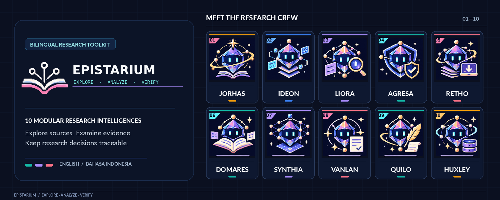
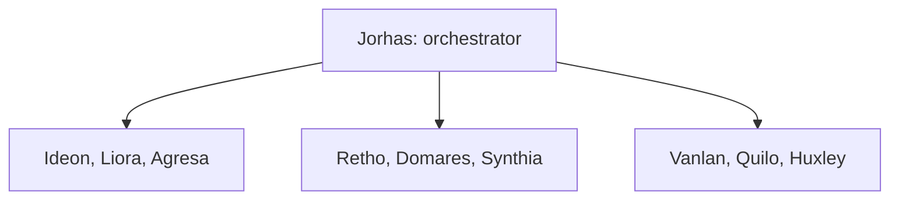

English | [Bahasa Indonesia](README.id.md)

<!-- EPISTARIUM_HERO_BEGIN -->

<!-- EPISTARIUM_HERO_END -->

<!-- section: identity -->
# EPISTARIUM

Explore. Analyze. Verify.

Modular AI Research Skills

v0.7.1 RELEASE_CANDIDATE. Ten research personas, English and Bahasa Indonesia, one codebase.

MIT covers original EPISTARIUM work. The runtime uses pypdfium2 and pypdf. Release gate: GO_BERSYARAT.
Read [licensing](docs/en/LICENSING.md) and [release readiness](reports/v0.7.1/RELEASE_READINESS.md).

<!-- section: quickstart -->
## Start here

On the GitHub repository page, choose **Code > Download ZIP**, or use the version 0.7.1 release ZIP asset when available. Extract it and open the folder with `pyproject.toml`, `AGENTS.md`, and `.agents/skills/`. The folder name depends on how you download the project.

Use Python 3.11 or later. Linux Python 3.12.14 was tested here. Other OS/Python combinations require their own checks.
First, read the [PDF licensing gate](docs/en/LICENSING.md).

On macOS or Linux:

```bash
python3 -m venv .venv
.venv/bin/python -m pip install .
.venv/bin/python -m epistarium doctor --lang en
.venv/bin/python -m epistarium ideon-origo --input examples/bilingual/origo.en.json --lang en --out private/first-map-en
```

On Windows PowerShell:

```powershell
py -3.14 -m venv .venv
.\.venv\Scripts\python.exe -m pip install .
.\.venv\Scripts\python.exe -m epistarium doctor --lang id
.\.venv\Scripts\python.exe -m epistarium ideon-origo --input examples/bilingual/origo.id.json --lang id --out private/first-map-id
```

The Windows example selects an installed Python 3.14. See its guide if that interpreter is missing.
These examples use synthetic input. The generated map is a draft, not research evidence.
Use a new output folder for every run. Select --lang en, --lang id, or --lang auto.
Language never changes source quotations, DOI values, names, numbers, or canonical status codes.

Follow [First Research](docs/en/FIRST_RESEARCH.md) to inspect the output and run a safe source-to-review workflow.

<!-- section: installation -->
## Install for your environment

[Windows 10/11](docs/en/install/windows.md) · [macOS Intel / Apple Silicon](docs/en/install/macos.md) · [Linux](docs/en/install/linux.md)

[OpenCode](docs/en/platforms/opencode.md) · [Google Antigravity](docs/en/platforms/antigravity.md) · [OpenAI Codex](docs/en/platforms/codex.md) · [ChatGPT](docs/en/platforms/chatgpt.md) · [Claude Code / Claude web](docs/en/platforms/claude.md) · [Gemini CLI / Gemini web](docs/en/platforms/gemini.md) · [GitHub Copilot](docs/en/platforms/copilot.md) · [Cursor](docs/en/platforms/cursor.md) · [Windsurf](docs/en/platforms/windsurf.md) · [Amp](docs/en/platforms/amp.md)

Native discovery is documented for several hosts. That is separate from a successful app execution.
See the [compatibility matrix](reports/v0.7.0/COMPATIBILITY_MATRIX.md) for PASS, BLOCKED, and NOT_RUN results.
The wheel installs Python tools only. The ZIP also includes skills, guides, examples, and tests.
EPISTARIUM does not provide a marketplace plugin or a verified npx installer.

<!-- section: catalog -->
## Meet the Research Intelligences

| Persona and title | Function | Request | Guides |
|---|---|---|---|
| Jorhas<br>The Path Finder | Master Diving | Find evidence and three possible focuses for student AI use. | [SKILL](.agents/skills/jorhas-master-diving/SKILL.md) · [Guide](.agents/skills/jorhas-master-diving/references/guide.en.md) |
| Ideon<br>The Research Architect | Topic Brainstormer / ORIGO | Build three research designs from my initial idea. | [SKILL](.agents/skills/ideon-topic-brainstormer/SKILL.md) · [Guide](.agents/skills/ideon-topic-brainstormer/references/guide.en.md) |
| Liora<br>The Literature Scout | Literature Scout | Find studies from the last five years on digital crisis communication. | [SKILL](.agents/skills/liora-literature-scout/SKILL.md) · [Guide](.agents/skills/liora-literature-scout/references/guide.en.md) |
| Agresa<br>The Index Sentinel | Index Verifier | Check these journals against the official index records I provide. | [SKILL](.agents/skills/agresa-index-verifier/SKILL.md) · [Guide](.agents/skills/agresa-index-verifier/references/guide.en.md) |
| Retho<br>The Paper Retriever | Fulltext Retriever | Check the permitted PDFs for these literature candidates. | [SKILL](.agents/skills/retho-fulltext-retriever/SKILL.md) · [Guide](.agents/skills/retho-fulltext-retriever/references/guide.en.md) |
| Domares<br>The Critical Reader | Critical Reader | Read these permitted articles and locate their method and findings. | [SKILL](.agents/skills/domares-critical-reader/SKILL.md) · [Guide](.agents/skills/domares-critical-reader/references/guide.en.md) |
| Synthia<br>The Knowledge Weaver | Literature Review | Build a literature matrix from these critical readings. | [SKILL](.agents/skills/synthia-literature-review/SKILL.md) · [Guide](.agents/skills/synthia-literature-review/references/guide.en.md) |
| Vanlan<br>The Evidence Guardian | Powerlink Verify | Check whether my paragraph is supported by the attached PDFs. | [SKILL](.agents/skills/vanlan-powerlink-verify/SKILL.md) · [Guide](.agents/skills/vanlan-powerlink-verify/references/guide.en.md) |
| Quilo<br>The Academic Scribe | Academic Writer | Review this draft and preserve quotes, numbers, citations, and uncertainty. | [SKILL](.agents/skills/quilo-academic-writer/SKILL.md) · [Guide](.agents/skills/quilo-academic-writer/references/guide.en.md) |
| Huxley<br>The Citation Cartographer | Citation-Reference Auditor | Check all citations against the references in this manuscript. | [SKILL](.agents/skills/huxley-citation-auditor/SKILL.md) · [Guide](.agents/skills/huxley-citation-auditor/references/guide.en.md) |

A persona is a research role with a defined task. Read [natural-language tutorials](docs/en/PERSONA_TUTORIALS.md).

<!-- section: modes -->
## Two research modes

Path Finding turns an idea into source/data ledgers, a timeline, three tentative directions, and a run manifest.
Its result remains PARTIAL. A source plan does not establish a research gap or causal claim.

Full Research coordinates nine specialists when their inputs exist. It records actual calls, files, hashes, and blocked or missing stages.
It remains a partial workflow. An idea alone cannot supply full-text, a manuscript, or human review.

Jorhas orchestrates these three groups of specialists:



The arrows show coordination. They do not imply every stage runs or automatically passes evidence to every other stage.
See [workflow handoffs](docs/en/WORKFLOW.md).

<!-- section: integrity -->
## Evidence integrity

An exact text match establishes a location, not substantive support. Metadata and abstracts are distinct from full-text.
A journal index record does not automatically establish article indexing. Unverified findings keep their evidence markers.
The researcher remains responsible for interpretations and conclusions.

English display files and local message catalogs share the same implementation as Indonesian outputs.
Quilo uses --preset academic-en for English manuscripts. --lang en controls report language separately.
Read the [evidence protocol](docs/en/EVIDENCE_PROTOCOL.md), [status glossary](docs/en/STATUS_GLOSSARY.md), and [language policy](docs/en/LANGUAGE.md).

<!-- section: maintenance -->
## Documentation and maintenance

[Documentation map](docs/en/INDEX.md) · [Test results](reports/v0.7.1/TEST_RESULTS.md) · [Security audit](reports/v0.7.0/SECURITY_AUDIT.md)

[Contribute](CONTRIBUTING.md) · [Migration](docs/en/migrations/0.6_to_0.7.md) · [Release notes](docs/en/releases/v0.7.1.md) · [Changelog](CHANGELOG.md)

[MIT original-work license](LICENSE) · [Third-party notices](THIRD_PARTY_NOTICES.md) · [PDF licensing resolution](reports/v0.7.1/LICENSING_RESOLUTION.md)

```bash
.venv/bin/python -m pip install -e ".[test]"
.venv/bin/python scripts/verify_skills.py
.venv/bin/python scripts/check_docs.py
.venv/bin/python scripts/check_english.py
.venv/bin/python -m pytest -q
.venv/bin/python -m build
```

On Windows, replace .venv/bin/python with .\.venv\Scripts\python.exe.
English follows [SimpleEnglish Plain 2.1.1](docs/style/SIMPLE_ENGLISH.md). Preserve its [MIT notice](third_party/SimpleEnglish/LICENSE).
Historical reports record earlier work. Current evidence is in reports/v0.7.1. Earlier reports are historical.
This alpha source distribution retains a conditional release gate. Review the current readiness report before production use.

Current PDF backend and release decision: [v0.7.1 readiness](reports/v0.7.1/RELEASE_READINESS.md).
