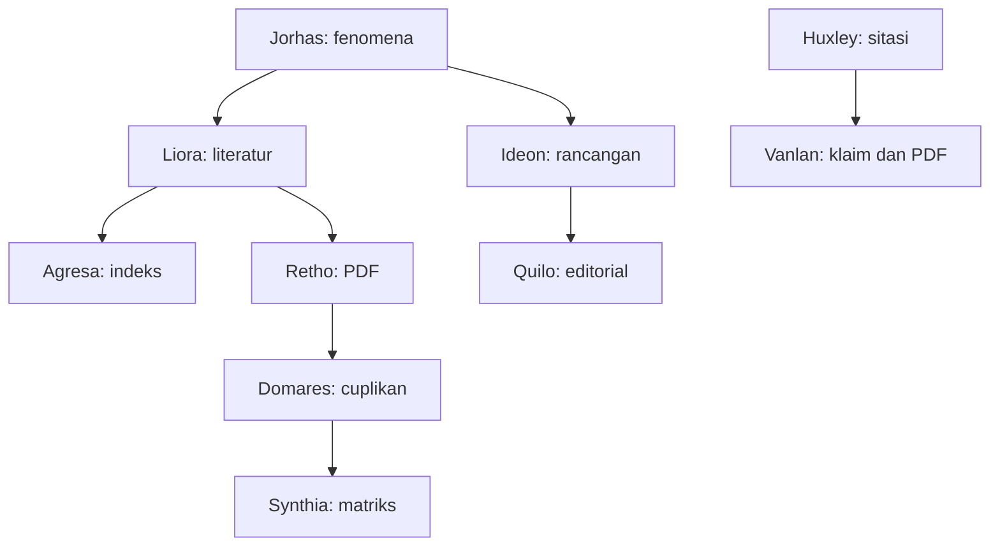

# Peta kerja sepuluh persona

| Permintaan pengguna | Mulai dari | Serah-terima |
|---|---|---|
| Ide mentah, bukti fenomena atau kelayakan sumber | Jorhas | Ledger dan peluang tentatif ke Ideon |
| Merapikan rancangan atau revisi pembimbing | Ideon | ORIGO DOCX/JSON ke pembacaan manusia dan Quilo |
| Mencari literatur | Liora | `candidates.json` ke Retho; daftar jurnal ke Agresa |
| Memeriksa indeks jurnal | Agresa | Arsip bukti indeks dan laporan, tanpa promosi indeks artikel |
| Memeriksa PDF lokal | Retho | `articles.json` ke Domares |
| Membaca kandidat isi paper | Domares | `critical_readings.json` ke Synthia atau penilaian manusia |
| Menyusun matriks literatur | Synthia | XLSX/CSV/JSON dan audit halaman ke peneliti |
| Mencocokkan klaim dengan PDF | Vanlan | Klaim dan anchor; keputusan substansi melalui review terpisah |
| Menyunting bahasa naskah | Quilo | Usulan TXT dan diff untuk ditelaah |
| Memeriksa sitasi dan daftar pustaka | Huxley | Audit pasangan; dukungan klaim dilanjutkan secara eksplisit ke Vanlan |

Panah Huxley ke Vanlan menunjukkan urutan kerja peneliti; ekspor otomatis klaim belum tersedia. `jorhas-full` hanya memanggil persona saat inputnya tersedia. Konteks ledger dan ID literatur diteruskan ke ORIGO sebagai bahan belum terverifikasi.

CLI memproduksi hasil deterministik. Agen dapat membaca cuplikan dalam konteks sumber, menjelaskan interpretasi dan menyusun usulan beridentitas bukti. Keputusan manusia tetap terpisah. Usulan AI tidak mengisi jumlah sampel, desain penelitian, DOI, atau status bukti yang belum didukung sumber.
